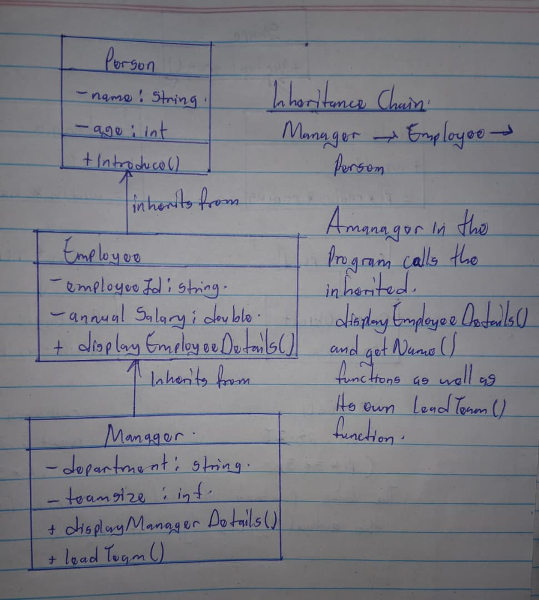
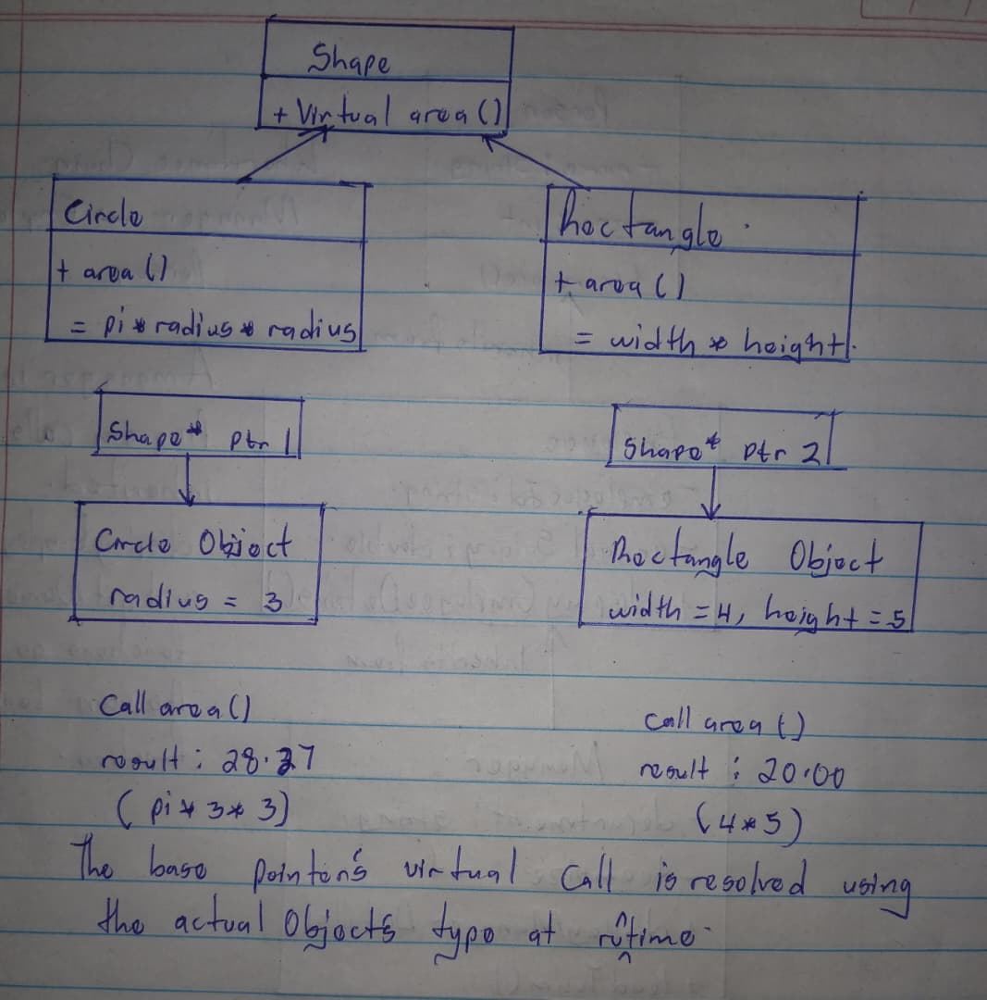

# C++ Inheritance and Polymorphism

This assignment contains two independent C++ programs. The first demonstrates
**chained (multilevel) inheritance**; the second demonstrates **runtime
polymorphism** through a base-class pointer. Each program has its own `main`
function and should be compiled as a separate executable.

## Requirements

- A C++ compiler with C++17 support, such as MinGW-w64 `g++`, GCC, Clang, or
  Microsoft Visual C++.
- A terminal or command prompt opened in this project directory.

The examples use only the C++ standard library; no additional packages are
required.

## 1. Chained inheritance

File: [`chained_inheritance.cpp`](./chained_inheritance.cpp)

The program models a workplace with three classes in an inheritance chain:

```text
Person
  └── Employee
        └── Manager
```

- `Person` stores a name and age and provides `introduce()`.
- `Employee` publicly inherits `Person`, adds an employee ID and salary, and
  provides `displayEmployeeDetails()`.
- `Manager` publicly inherits `Employee`, adds a department and team size, and
  provides `displayManagerDetails()` and `leadTeam()`.

The `main` function creates both an `Employee` and a `Manager`. The manager's
details method uses members inherited through both levels of the chain, while
`leadTeam()` demonstrates a member defined only by `Manager`.

### Hand-drawn illustration

The following hand-drawn diagram shows the class hierarchy, members, and
inheritance relationships used in this example:



Example run:

```text
=== Chained Inheritance: Workplace Roles ===
Employee details:
Name: Maya Chen
Age: 29
Employee ID: E104
Annual salary: $72000.00

Manager details:
Name: Jordan Lee
Age: 41
Employee ID: M201
Annual salary: $105000.00
Department: Engineering
Team size: 8
Jordan Lee is leading the Engineering team of 8 people.
```

## 2. Runtime polymorphism

File: [`polymorphism.cpp`](./polymorphism.cpp)

The program models geometric shapes using a base class and two derived
classes:

```text
       Shape
       /   \
   Circle  Rectangle
```

`Shape` declares the pure virtual `area()` function and a virtual destructor.
`Circle` and `Rectangle` each override `area()` with their own calculation.
The program stores pointers to both concrete objects in an array of
`Shape*` pointers and calls `area()` through each pointer. The same call is
dispatched to the implementation belonging to the pointed-to object.

### Hand-drawn illustration

The following hand-drawn diagram shows the `Shape` base class, its derived
classes, base-class pointers, and the different results of calling `area()`:



Example run:

```text
=== Runtime Polymorphism: Shape Areas ===
Circle area: 28.27 square units
Rectangle area: 20.00 square units
```

## Build and execute

### MinGW-w64, GCC, or Clang

Compile each source file separately from the project directory:

```powershell
g++ -std=c++17 -Wall -Wextra -pedantic chained_inheritance.cpp -o chained_inheritance.exe
g++ -std=c++17 -Wall -Wextra -pedantic polymorphism.cpp -o polymorphism.exe
```

Run the programs in PowerShell:

```powershell
.\chained_inheritance.exe
.\polymorphism.exe
```

On Linux or macOS, omit the `.exe` suffix when compiling and run the programs
with `./chained_inheritance` and `./polymorphism`.

### Microsoft Visual C++

From a Developer Command Prompt for Visual Studio, compile and run each
program separately:

```text
cl /std:c++17 /EHsc /W4 chained_inheritance.cpp
chained_inheritance.exe
cl /std:c++17 /EHsc /W4 polymorphism.cpp
polymorphism.exe
```

Both hand-drawn illustration photos are included in this repository and
embedded above in the relevant assignment sections.